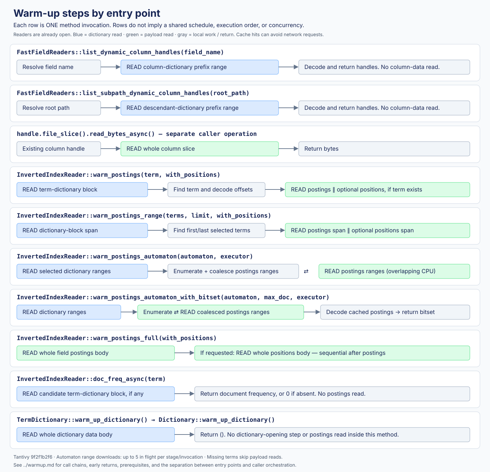

# Warm-up steps by entry point



Scope: Tantivy `9f2f1b2f6` in this checkout. Each section describes one method invocation. These methods are alternatives or building blocks. They do not form one combined pipeline.

`READ` means a logical asynchronous file-range read. Whether it produces a network request depends on the supplied directory and caches. Opening readers is a prerequisite outside these method bodies and is not counted here.

## Fast-field metadata entry points

### `FastFieldReaders::list_dynamic_column_handles(field_name)`

```text
Resolve field name locally
  → ColumnarReader::read_columns_async(resolved_name)
  → READ column-dictionary range for prefix resolved_name + '\0'
  → Decode column types and byte ranges into handles
  → Return Vec<DynamicColumnHandle>
  STOP: no column-data read in this method
```

An unresolvable field name returns an empty vector before reading the dictionary. A resolved name can produce zero, one, or multiple typed column handles. The dictionary prefix lookup reads a contiguous span of SSTable blocks.

### `FastFieldReaders::list_subpath_dynamic_column_handles(root_path)`

```text
Resolve root path locally
  → ColumnarReader::read_subpath_columns_async(resolved_name)
  → READ column-dictionary range for prefix resolved_name + JSON_PATH_SEGMENT_SEP
  → Decode descendant column types and byte ranges into handles
  → Return Vec<DynamicColumnHandle>
  STOP: no column-data read in this method
```

This is a separate entry point. It does not call `list_dynamic_column_handles()` first.

### Separate caller operation: `handle.file_slice().read_bytes_async()`

```text
An existing column handle
  → READ the whole column slice
  → Return bytes
```

A caller can compose handle listing with this operation to warm a fast field. That composition is not performed by either listing method above. One field may return multiple handles, requiring a caller decision about which columns to read and how to schedule them.

Sources: [`src/fastfield/readers.rs:266–293`](../src/fastfield/readers.rs), [`columnar/src/columnar/reader/mod.rs:53–76,161–195`](../columnar/src/columnar/reader/mod.rs), [`columnar/src/dynamic_column.rs:260`](../columnar/src/dynamic_column.rs), [`common/src/file_slice.rs:234`](../common/src/file_slice.rs).

## Inverted-index entry points

### `InvertedIndexReader::warm_postings(term, with_positions)`

```text
get_term_info_async(term)
  → Locate candidate dictionary block using the loaded index
  → READ that dictionary block, if a candidate exists
  → Find term and decode TermInfo
      ├─ absent: return false
      └─ present:
           READ postings range ────────────┐
           READ positions range, if asked ─┴─ concurrent
           → return true
```

For a present term: two reads without positions, three with positions, in two dependent read stages. The postings and positions offsets both come from `TermInfo`.

### `InvertedIndexReader::warm_postings_range(terms, limit, with_positions)`

```text
get_term_range_async(terms, AlwaysMatch, limit, 0)
  → READ a contiguous dictionary-block span
  → Enumerate matching TermInfo entries, applying the limit
      ├─ no entries: return false
      └─ entries:
           READ postings span from first start to last end ─┐
           READ corresponding positions span, if asked ────┴─ concurrent
           → return true
```

For a nonempty result: two reads without positions, three with positions. It reads one postings span, rather than one range per matching term.

### `InvertedIndexReader::warm_postings_automaton(automaton, executor)`

```text
Select candidate dictionary ranges using the loaded index
  → Coalesce dictionary ranges across gaps up to 4 MiB
  → READ dictionary ranges, up to 5 in flight
  → Wait for all dictionary reads
  → Run term enumeration on the supplied executor
      → Synchronous dictionary reads, assumed cached
      → Coalesce matching postings ranges across gaps up to 4 MiB
      → Send ranges through a channel
           ⇄ READ postings ranges, up to 5 in flight
  → Join enumeration and downloads
  → Return whether any postings slices were downloaded
```

CPU enumeration overlaps postings downloads. This method reads no positions. The concurrency limits apply per invocation, not globally. An always-matching automaton can use the contiguous dictionary-range path instead.

### `InvertedIndexReader::warm_postings_automaton_with_bitset(automaton, max_doc, executor)`

```text
Select/coalesce dictionary ranges
  → READ dictionary ranges, up to 5 in flight
  → Wait for all dictionary reads
  → Executor: enumerate terms and send coalesced postings ranges
       ⇄ READ postings ranges, up to 5 in flight
  → Wait for enumeration and downloads
  → Executor: enumerate again and decode cached postings
  → Build and return a BitSet of matching document IDs
```

The final bitset pass is additional CPU work with synchronous reads from the populated cache. This method reads no positions and explicitly requires a directory that caches asynchronous reads for subsequent synchronous access.

### `InvertedIndexReader::warm_postings_full(with_positions)`

```text
READ the entire field postings body
  → Wait for completion
  → If with_positions:
       READ the entire field positions body
       → Wait for completion
  → Return ()
```

This method performs no term-dictionary read. With positions enabled, the two reads are **sequential**, unlike `warm_postings()` and `warm_postings_range()`.

### `InvertedIndexReader::doc_freq_async(term)`

```text
get_term_info_async(term)
  → Locate candidate dictionary block using the loaded index
  → READ that dictionary block, if a candidate exists
  → Return TermInfo.doc_freq, or 0 if absent
```

This is a metadata lookup rather than a postings warm-up. It reads neither postings nor positions.

Source for these methods: [`src/index/inverted_index_reader.rs:314–583`](../src/index/inverted_index_reader.rs).

## Dictionary entry point

### `TermDictionary::warm_up_dictionary()`

```text
Delegate to underlying Dictionary::warm_up_dictionary()
  → READ self.sstable_slice (entire dictionary data body)
  → Wait for completion
  → Return ()
```

This method performs one logical read. It neither opens the dictionary nor downloads postings. The dictionary index/footer were read when the reader was opened, outside this invocation.

Sources: [`src/termdict/mod.rs:168`](../src/termdict/mod.rs), [`sstable/src/dictionary.rs:633`](../sstable/src/dictionary.rs).

## Comparison

Counts assume present, nonempty data. Empty ranges and cache hits can avoid remote I/O.

| Entry point | Dictionary reads inside this call | Payload reads inside this call | Internal ordering |
|---|---|---|---|
| `list_dynamic_column_handles` | One column-dictionary span | None | Read → decode handles → return |
| `list_subpath_dynamic_column_handles` | One descendant-dictionary span | None | Read → decode handles → return |
| `handle.file_slice().read_bytes_async()` | None | One whole column | Single read |
| `warm_postings` | One term block | Postings + optional positions | Dictionary → parallel payload reads |
| `warm_postings_range` | One term-dictionary span | Postings span + optional positions span | Dictionary → parallel payload reads |
| `warm_postings_automaton` | Selected/coalesced ranges | Coalesced postings ranges | Dictionary → enumeration overlapping downloads |
| `warm_postings_automaton_with_bitset` | Selected/coalesced ranges | Coalesced postings ranges | Same download stages → cached decoding into bitset |
| `warm_postings_full` | None | Whole postings + optional whole positions | Postings → positions, sequential |
| `doc_freq_async` | At most one term block | None | Dictionary → return frequency |
| `warm_up_dictionary` | Whole dictionary body | None | Single read |

## What is outside this diagram

- **Reader opening:** `SegmentReader`, `ColumnarReader`, and dictionary opening have their own metadata reads. They are prerequisites, not steps inside every warm-up call.
- **Caller orchestration:** a caller chooses entry points, sequences or joins them, and may cancel them. This document does not impose a common schedule on these APIs.
- **Fieldnorm warm-up:** this checkout exposes fieldnorm slices through `fieldnorms_readers().get_inner_file().open_read(field)`. A caller can read those slices asynchronously. There is no corresponding Tantivy `warm_up_fieldnorms()` method here.
- **Network request counts:** these depend on directory implementations, caches, overlapping reads, empty ranges, and retries. No runtime request trace was collected.
